MASAR User Manual

# MASAR USER MANUAL

 display how many points in saved data

## MASAR User Manual, Editors Draft, 26-Oct-2012

This version:[userManual_20121026.html](http://epics-pvdata.hg.sourceforge.net/hgweb/epics-pvdata/masarService/raw-file/tip/documentation/userManual.html)Latest version:[userManual.html](http://epics-pvdata.hg.sourceforge.net/hgweb/epics-pvdata/masarService/raw-file/tip/documentation/userManual.html)Editors:Guobao Shen, BNL
 Marty Kraimer, BNL

## Table of Contents

- [Abstract](#abstract)
- [Status of this Document](#status)
- [Introduction](#introduction)
- [NOTE](#note)
- [System Requirement](#requirement)
- [Terminology](#terminology)
- [System Architecture](#architecture)
- [MASAR Server](#server)

  - [Functions](#functions)
  - [Data Format](#dataformat)

- [Relational Database](#database)

  - [SQLite3 Schema](#sqlite3)
  - [IRMIS Schema](#irmis)
  - [Create Database](#createdb)
  - [Database configuration](#configdb)

- [Install from source](#installation)

  - [Preparation](#prepareinstall)
  - [Install pvDataCPP](#pvdatainstall)
  - [Install pvAccessCPP](#pvaccessinstall)
  - [Install pvIOCCPP](#pviocinstall)
  - [Install normativeTypes](#ntinstall)
  - [Install masarService](#masarinstall)

- [Run MASAR Server](#runserver)

  - [Python/C module](#pythonc)
  - [PYTHONPATH](#pythonpath)
  - [MASAR SQLite database](#masardb)
  - [Launch MASAR service](#launchserver)
  - [Launch MASAR with other name](#launchserver2)
  - [Stop MASAR service](#stopserver)

- [MASAR Client](#masarclient)

  - [Python API](#pythonapi)
  - [Default GUI](#clientgui)

## Abstract

MASAR (MAchine Snapshot, Archiving, and Retrieve) is an EPICS V4 service. The server and client are implemented in C++ and Python. The server takes machine snapshots, archives data in a relational database, and retrieves data from the database. The client provides a GUI that retrieves data, compares data with the live machine, and restores the machine with given snapshot data. The client also provides support for other python and C++ code.

The server takes machine snapshot by using pre-defined configurations. To take a snapshot the client specifies the name of the snapshot configuration and a name for this snapshot event.When the server receives a command to take a machine snapshot, the server retrieves, from the database, the list of V3 channel names for the configuration. It then gets the current value of all the channels from V3 IOC, and saves the data as a snapshot event into the database.

## Status of this Document

This is the 26-Mar-2012 version of the MASAR User Manual.

## Introduction

MASAR is implemented in C++ and Python. Network communication is implemented via the EPICS V4 channelRPC mechanism . The current implementation uses SQLite3 for the relational database. A Python module PYMASAR provides access to SQLite3.

Since EPICS V4 channelRPC server is implemented in C++, the interface between the masar server and PYMASAR is implemented using Python/C. A Python API is provided for the client user, and a default PyQt4 GUI is developed for end user.

The products are all part of the [V4](http://epics-pvdata.sourceforge.net) implementation of [Experimental Physics and Industrial Control System](http://www.aps.anl.gov/epics), which are available via an [open source license](http://epics-pvdata.sourceforge.net/LICENSE.html).

For now the only way to obtain the MASAR service is from the sourceforge mercurial repository. Binary packages are available for Debian 7.0 (Wheezy).

## NOTE

1. In the database, time is stored as UTC/POSIX time started from Jan, 1st, 1970. There is a constant time shift in second since the seconds past EPOCH used by EPICS V3 starts from Jan 1st, 1990.
2.  Since all time stored in the RDB is in the UTC time format, the client Python API returns all raw data, which means time is in UTC format. This impacts the API user.
3.  For the human being reading convenience, the default PyQt4 GUI displays it in local time.
4. All timestamps in service_event, service_config, and pv_group tables are the time when inserting data into database. This means that the time stamp for a particular snapshot is the time when the data is inserted into database.
5. Since the enum is converted to a string, it captures its label (display value) instead of its real value(0, 1, ...). Advantage doing that is if there is any changes on enum label, it probably means some V3 IOC database logic has changed. It is better to throw a message to show that explicitly.
6.  The compare and restore functions are provided only in PyQt4 GUI. Client user needs to use Python Client API to compare any sets of snapshot data, and manipulate the data.
7.  For restore function, instead of slowly and synchronously ramping the value to given setting point, the MASAR GUI sets the value whatever it is to the IOC directly. It might be dangerous if IOC or other gateway does not protect it. The restore function sets only the stored value back to IOC.
8.  The restore function does not verify a pv is a read-back or set-point.

## System Requirement

To run MASAR on you machine, Python and various EPICS V3 and V4 run-time library are required for both client and server.

Python:

- Python 2.7 or above

EPICS modules:

- EPICS V3 base R3.14.11 or above. Current release is R3.14.2, which can be downloaded from [here](http://www.aps.anl.gov/epics/base/R3-14/12.php).

- [EPICS V4](http://epics-pvdata.sourceforge.net/) (managed by mercurial on source forge)

  - [pvDataCPP](http://epics-pvdata.hg.sourceforge.net/hgweb/epics-pvdata/pvDataCPP/raw-file/tip/documentation/pvDataCPP.html)
  - [pvAccessCPP](http://epics-pvdata.hg.sourceforge.net/hgweb/epics-pvdata/pvAccessCPP/raw-file/tip/documentation/pvAccessCPP.html)
  - [pIOCCPP](http://epics-pvdata.hg.sourceforge.net/hgweb/epics-pvdata/pvIOCCPP/raw-file/tip/documentation/pvIOCCPP.html)
  - [normativeTypes](http://epics-pvdata.sourceforge.net/alpha/normativeTypes/normativeTypes.html)
 The normative types implementation is under alpha version, which is under alphaCPP module.
  - [masarService](http://epics-pvdata.hg.sourceforge.net/hgweb/epics-pvdata/masarService/raw-file/tip/documentation/userManual.html)

For MASAR server, you need:

- SQLite3 3.7 or above

For MASAR client default GUI:

- PyQt4 4.8 or above

Currently, MASAR has been installed on the following systems:

- Ubuntu 11.04 (Natty Narwhal)

- Debian 7.0 (Wheezy)
- Fedora 14
- Fedora 16
- Mac OS-X 10.6.8 (Snow Leopard)

## Terminology

 in addition to the terminology used by EPICS, MASAR defines the following:

- pv group: A unique group.It has a name, list of V3 channel names, description, and date when group was created.
- service config: A unique configuration. It has a name, pv group name, description, and syatem to which system it belongs.
- system: Identifies the sub system to which each configuration belongs.
- service event: Description of a snapshot. It has comment, author name, date, and status;
- snapshot: The data for a snapshot event.
- interface name convention

  - putXXXX(): put into a live machine, more specifically, an EPICS live pv
  - getXXXX(): get from a live machine, more specifically, an EPICS live pv
  - saveXXX(): save into a RDB
  - retrieveXXX(): retrieve from a RDB

## System Architecture

 The MASAR consists of client and server :

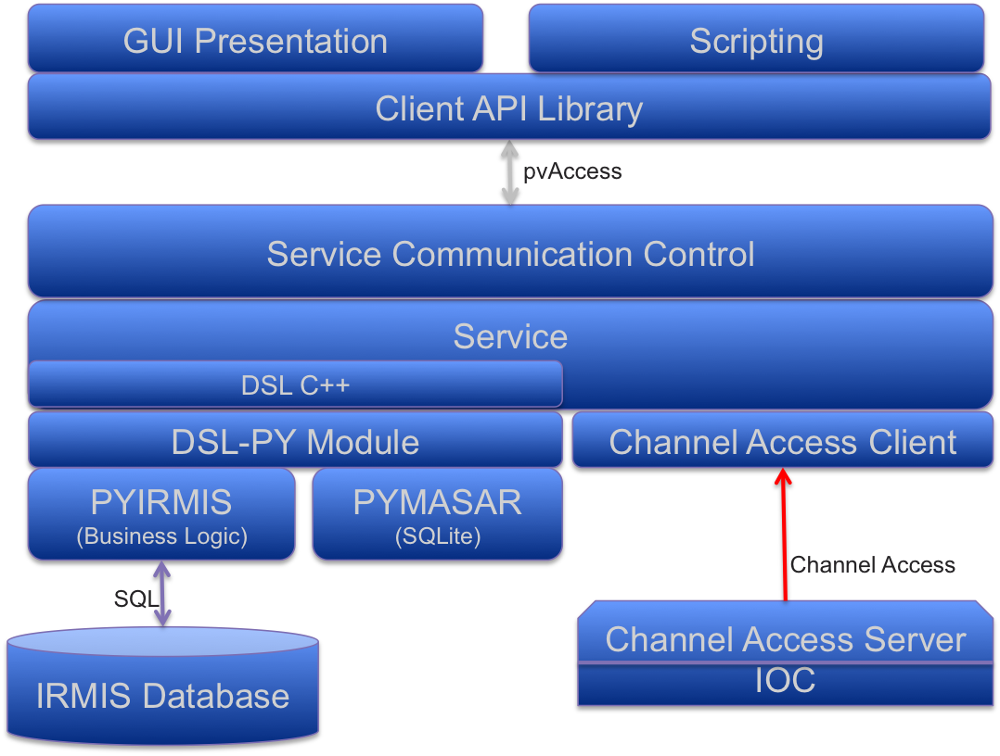
MASAR Architecture

The client has a client Python API library, which can be used by both Python scripting, and the GUI. A default PyQt4 GUI is developed for data viewing, snapshot taking, comparing a snapshot with live machine, and restoring machine to a particular status using a snapshot.

The server has 4 layers:

- Service communication control: the pvAccess channel RPC instance.
- Service: parses a command from the client, implements desired action, and returns the result to the client.
- Channel Access Client: For now the only usage to to get the current value of a set of V3 channels.
- DSL (data source layer): This is the interface between C++ and Python.

  - PYMASAR: A Python module to access SQLite3 database, which is supported by default currently;
  - PYIRMIS: A Python module to access IRMIS/MySQL database, which will be supported in the future.

- Data layer.

  - IOC: live machine data;
  - IRMIS: static data, which can have all machine configuration.
  - MASAR: embedded inside PYMASAR, which is dedicated to MASAR service.

## MASAR Server

 The MASAR server can take a snapshot for any combination of EPICS channels, including scalar channels of type string, enum, byte (8-bit), short (16-bit), int (32-bit), long (which is same with integer in EPICS V3), float, and double, and/or waveform/array pv with any above types except enum. Since the data types supported by both Python and SQLite3/IRMIS are string, int, and real, the types are casted as below:

epics data typedata type carried by MASAR
enum, stringstring
byte, short, int/longlong
float, doubledouble
 The waveform data is casted following above rule, and stored as a BLOB in database after being serialized into binary. At current stage, the BLOB is one field of masar_data table, and might be separated as a standalone table if there is any performance issue.

### Functions

The MASAR server side supports 6 fundamental functions to talk with RDB:

1. retrieveServiceConfigProps: current MASAR database schema defines an associated property table, service_config_prop, to host some user defined properties. One typical use is which sub-system one particular configuration belongs to. This function is to get a full list of sub-system that are defined for MASAR service in database.
2. retrieveServiceConfigs: get a list of the snapshot configurations with filter based on snapshot names.
3. retrieveServiceEvents: get a list how many snapshot events have been taken with filters based on snapshot names, author, and time range.
4. retrieveSnapshot: get real snapshot data;
5. saveSnapshot: save a snapshot into database;
6. updateSnapshotEvent: update a particular snapshot, for example flag a snapshot as approved;

 Function NOT supported by the server:

1. Comparing two different snapshots. This is a function inside client part, and user can do it using Python interface.
2. Comparing an archived snapshot with current live machine. This is a function inside client part, and is supported in PyQt4 GUI by default.
3. Restoring machine to a particular snapshot status. The MASAR server has unidirectional access to EPICS V3 IOC, which means reads value only. Restoring is a function inside client part, and is supported in PyQt4 GUI by default.
4. Change pv name. We thought about pv name changes, but do not support this function at current release.
5. Add new pv name to existing configuration. We thought about adding a new pv name to a group, but do not support it at current release. Since adding a new pv is changing the configuration definition in fact, it is encouraged to create a new configuration. Please refer "Database configuration" section about how to create a new configuration. User is encouraged to define a new configuration, then ask service manager or database administrator to load the configuration into database.
6. Reuse configuration name. We have a request that new group maintains old group name and old group becomes deprecated. But this is not in the initial implementation.
7. Version control for configuration changes. We considered to adopt version control to tracking configuration changes, for example, adding a new pv to existing pv_group, changing group name, and so on. But this is not in the initial implementation.

### Data Format

When a MASAR request is sent from client to server, NTNameValue type is used to carry parameters, which is as below:

```
structure NTNameValue
   string[]    names
   string[]    values
   string      function xxxxxx // function name as above
```

 The name/value pair is converted into a Python dictionary inside service layer, and transferred to PYMASAR/PYIRMIS layer. Acceptable names for above 6 functions are listed as below:

```
retrieveServiceConfigProps:
        names = ["propname", "servicename", "configname"]
retrieveServiceConfigs:
        names = ["servicename", "configname", "system"]
retrieveServiceEvents:
        names = ["configid", "start", "end", "comment", "user"]
retrieveSnapshot:
        names = ["eventid", "start", "end", "comment"]
saveSnapshot:
        names = ["servicename","configname","comment"]
updateSnapshotEvent:
        names = ["eventid", "user", "desc"]
```

The results from server are carried using a NTTable as below:

```
structure NTTable
    structure timeStamp
        long secondsPastEpoch 0
        int nanoSeconds 0
        int userTag 0
    structure alarm
        int severity 0
        int status 0
        string message
    string[] label [...]
    ... // value field
```

## Relational Database

### SQLite3 Schema

 Currently, SQLite3 is the only database supported by MASAR service. Its original schema is inherited from IRMIS, and now is as below:

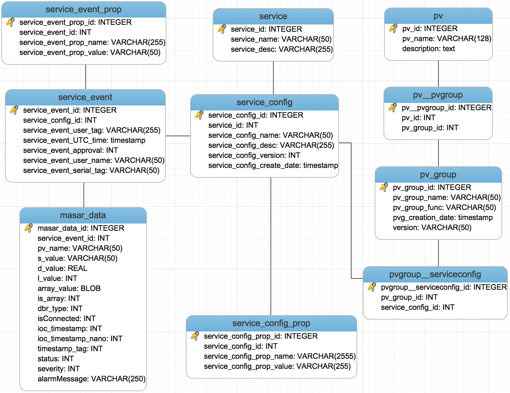
MASAR SQLite3 Schema

### IRMIS Schema

 When IRMIS support is implemented the DSL layer will make switching between the different relational database almost seamless. However the database schemas must be similar. For example to minimize the effort when switching from SQLite to IRMIS, the IRMIS schema will be similar to the SQLite3 schema.

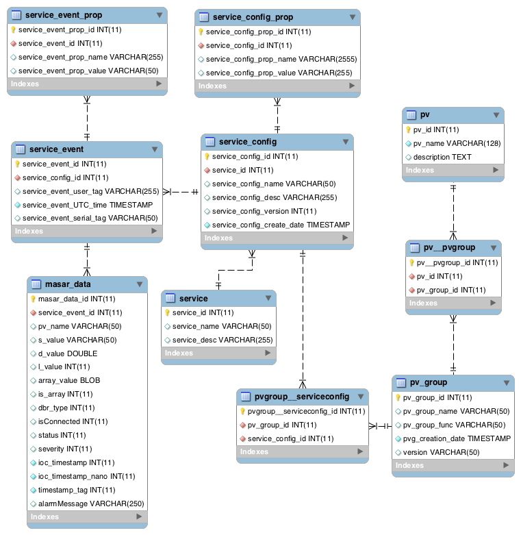
MASAR IRMIS Schema

### Create Database

This section is for SQLite3 database only. The files for SQL are located in directory:

```
masarService/python/pymasar/db
```

The generated data base will be stored in a place You specify. You also need to create a directory that holds text files that each has a list of V3 channel names. There is an example directory located in:

```
masarService/example
```

It has a subdictory pvs that has example channel list files. For example pvs/example.txt contains:

```
masarExample0000
masarExample0001
 ...
masarExample0999
```

The SQL file is masars-qlite.sql. File createmasardb.py is the Python script that create an SQLite3 database. An example of how to create a MASAR database is:

```
$cd masarService/example
$python ../python/pymasar/db/createmasardb.py
```

 This creates a new MASAR database called "masar.db" that is located in the example directory. If there is an error like:

```
create a new SQLite db.
Traceback (most recent call last):
  File "../python/pymasar/db/createmasardb.py", line 109, in <module>
    createMasarDb()
  File "../python/pymasar/db/createmasardb.py", line 59, in createmasardb
    from pymasar.db.masarsqlite import SQL
ImportError: No module named pymasar.db.masarsqlite
```

 Check the PYTHONPATH setting.

If the "masar.db" exists already, you will be asked

```
SQLite database masar.db exists already.
Do you want to overwrite it? Yes, [N]o (default = No):
```

Choose Yes to overwrite current masar.db file, otherwise No.

If you want to give database file a name instead of using default "masar.db", you can do

```
$ python ../python/pymasar/db/createmasardb.py -db test.db
SQLite3 database:  test.db
create a new SQLite db: test.db.
```

After created MASAR database, an environment variable needs to be set as (BASH environment)

```
export MASAR_SQLITE_DB=~/V4/masarService/example/masar.db
```

 If the database is named differently, use right database file name.

### Database configuration

This section is also only for an SQLite3 database and again the files described below are located in:

```
masarService/python/pymasar/db
```

After creating the SQLite3 database, it has to be initialized, and some information about service configuration have to be configured in advance before allowing MASAR server uses it.

The database configuration, which is an administrative work, is separated from MASR service, and could be done through calling PYMASAR API. A Python Script, configmasardb.py, initializes and configures the database. This is also located in:

```
masarService/python/pymasar/db
```

The following is an example showing how to configure MASAR database.

Site-specific information is configured in settings.py, which has format as below:

```
# pv group name: [pv list file, description]
pvgroups= {
    'test':         ['example.txt', 'server test'],
    'wftest':       ['exampleWf.txt', 'server test with waveform'],
    'bigwftest':    ['exampleBigWf.txt', 'server test with big waveform']
}

# config name: [config desc, system]
configs= {
    'sr_test':      ['test pv config', 'test'],
    'wf_test':      ['waveform test pv config', 'test'],
    'bwf_test':     ['big waveform test pv config', 'test']
}

# config name: [pvgroup,]
pvg2config= {
    'sr_test':   ['test'],
    'wf_test':   ['wftest'],
    'bwf_test':  ['wftest', 'bigwftest']
}
```

There are 3 variables defined in settings.py

1. pvgroups. A Python dictionary with group name as key. Each pv group is a collection of V3 channel names. The value is a the name of a file that holds a list of channel names and configuration description. The pv group name has to be global unique.
2. configs. It is a Python dictionary with configure name as key. Each config has a Python list as its value, which includes configure description, and which system it belongs to. The config name has to be global unique.
3. pvg2config. It is a Python dictionary with configure name as key. The value of each key is a collection list of pv group name.

After the settings.py is configured, configmasardb.py creates the database. Assume the database is called masar.db, and is located in masarService/example

```
$ python ../python/pymasar/db/configmasardb.py
```

 it requests the absolute path of pv list file directory.

```
Please give absolute ROOT PATH of your pv list files
[default: /home/xxxx/V4/masarService/python/pymasar/db/pvs]:
```

 here give the pv list directory PATH, for example /home/xxxx/V4/masarService/pvs:

```
/home/xxxx/V4/masarService/example/pvs
Use new ROOT: /home/xxxx/V4/masarService/example/pvs
```

If the path is wrong, it raises an exception. After loading pv names into database, it tries to save configuration. If a configuration exists already, it reports for example, and ignores that configuration:

```
configuration name (bwf_test) exists already.
configuration name (sr_test) exists already.
configuration name (wf_test) exists already.
```

After finished the database configuration, it is ready to launch MASAR server.

## Install from source

At current stage, all EPICS V4 packages are available as source code, which can be checked out from by sourceforge mercurial repository. To compile all V4 module Python 2.7 and EPICS V3 development packages must be installed. EPICS V3 base is available as a Debian package from [NSLS-II Debian package server](http://epics.nsls2.bnl.gov/debian/). Here we assume EPICS V3 base is installed under /usr/lib/epics.

 A step-by-step installation is introduced here, and the example is to show how to install whole packages on Ubuntu 11.04 x86_64 system. You should be able to install all modules on other systems following the same procedure. You can check your system architecture using for example on linux:

```
$ uname -m
x86_64
```

### Preparation

Here we assume you want to install all modules under ~/V4

```
$ cd
$ mkdir V4
$ cd V4
$ hg clone http://epics-pvdata.hg.sourceforge.net/hgroot/epics-pvdata/pvDataCPP
$ hg clone http://epics-pvdata.hg.sourceforge.net/hgroot/epics-pvdata/pvAccessCPP
$ hg clone http://epics-pvdata.hg.sourceforge.net/hgroot/epics-pvdata/pvIOCCPP
$ hg clone http://epics-pvdata.hg.sourceforge.net/hgroot/epics-pvdata/normativeTypesCPP
$ hg clone http://epics-pvdata.hg.sourceforge.net/hgroot/epics-pvdata/masarService
```

If you are inside an internal network, and have some proxy setting, you might hit a connection error during cloning a module like:

```
abort: error: Connection refused
```

Please consulate your network manager, or you can try to set your http_proxy environment, for example, on BASH shell:

```
export http_proxy=http://your.proxy.server.name:port
```

 NOTE: Make sure you have following line in each module in configure/RELEASE. Suggest to put it as the last line if it is not.

```
-include $(TOP)/configure/RELEASE.local
```

### Install pvDataCPP

```
$ cd pvDataCPP
```

 Add the following to configure/RELEASE.local

```
EPICS_BASE=/usr/lib/epics
```

 Then

```
$ make
```

### Install pvAccessCPP

```
$ cd ../pvAccessCPP
```

 Add the following to configure/RELEASE.local

```
PVDATA=~/V4/pvDataCPP
EPICS_BASE=/usr/lib/epics
```

 Then

```
$ make
```

### Install pvIOCCPP

```
$ cd ../pvIOCCPP
```

 Add the following to configure/RELEASE.local

```
PVDATA=~/V4/pvDataCPP
PVACCESS=~/V4/pvAccessCPP
EPICS_BASE=/usr/lib/epics
```

 Then

```
$ make
```

### Install normativeTypes

```
$ cd ../normativeTypesCPP/
```

 Add the following to configure/RELEASE.local

```
PVDATA=~/V4/pvDataCPPPVACCESS=~/V4/pvAccessCPPEPICS_BASE=/usr/lib/epics
```

 Then

```
$ make
```

### Install masarService

```
$ cd ../../masarService/cpp
```

 Add the following to configure/RELEASE.local

```
PYTHON=python2.7
PYTHON_BASE=/usr
$(PYTHON)_DIR = $(PYTHON_BASE)/lib/$(PYTHON)/config
NUMPY_CORE=${PYTHON_BASE}/lib/${PYTHON}/site-packages/numpy/core

PVDATA=~/V4/pvDataCPP
PVACCESS=~/V4/pvAccessCPP
PVIOC=~/V4/pvIOCCPP
NTTYPE=~/V4/alphaCPP/normativeTypes

EPICS_BASE=/usr/lib/epics
```

Caveat: On multi-arch systems, the /lib/ directory part might have to be replaced with a different string, including the architecture name triplet. E.g., /lib/x86-linux-gnu/.

Then

```
$ make
```

The installation procedure is complete if the above is successful.

If it hits a problem like

```
 fatal error: Python.h: No such file or directory
```

 it means the python devel library is not installed. Please check your system, and install missing library. For example, on a debian dist:

```
sudo apt-get install python2.7-dev
```

## Run MASAR Server

After installing all required modules and configuring the sql database the last step is to prepare and check the Python environment.

### Python/C module

 Python looks for the shared library to load modules. You need to create some symbol links if it is not done yet.

```
$ cd
$ cd ~/V4/masarService/cpp/src/python
$ python generateSOLinks.py
```

 If you did not set EPICS_HOST_ARCH environment, you will be promoted as below:

```
EPICS_HOST_ARCH is not setted.
Please specify EPICS_HOST_ARCH:
```

You can specify your host architecture here, for example, linux-x86_64 if you are using a 64-bit linux machine. An error will occur as below if the EPICS_HOST_ARCH is wrong:

```
EPICS_HOST_ARCH is not setted.
Please specify EPICS_HOST_ARCH:linux-x86
Traceback (most recent call last):
  File "generateSOLinks.py", line 32, in <module>
    fileList = os.listdir(libDir)
OSError: [Errno 2] No such file or directory: '../../lib/linux-x86'
```

An alternative solution is to set the environment before running generateSOLinks.py, for example:

```
$ export EPICS_HOST_ARCH=linux-x86_64
```

### PYTHONPATH

 The PYTHONPATH must be defined as follows. It could be defined in .bash_profile

```
$ export PYTHONPATH=~/V4/masarService/python
$ export PYTHONPATH=${PYTHONPATH}:~/V4/masarService/cpp/src/python
```

### MASAR SQLite database

 You also need to set the MASAR_SQLITE_DB to allow PYMASAR module to find the SQLite3 database. Here is an example. It can also be put in .bash_profile

```
$ export MASAR_SQLITE_DB=~/V4/masarService/example/masar.db
```

Now it is ready to go.

### Launch MASAR service

The following packages are needed to run MASAR server.

- Python 2.7 or above
- SQLite3 3.7 or above

```
$ cd ~/V4/masarService/cpp
$ ./bin/linux-x86_64/masarServiceRun
```

 You will see the following output

```
ChannelBaseProvider::ChannelBaseProvider pvService
VERSION : CA Server v0.9.0
PROVIDER_NAMES : pvService
BEACON_ADDR_LIST :
AUTO_BEACON_ADDR_LIST : 1
BEACON_PERIOD : 15
BROADCAST_PORT : 5067
SERVER_PORT : 5066
RCV_BUFFER_SIZE : 16384
IGNORE_ADDR_LIST:
STATE : INITIALIZED
masarService
Type exit to stop:
```

You have started the server now successfully. However, if you see this output:

```
ChannelBaseProvider::ChannelBaseProvider pvService
VERSION : CA Server v0.9.0
PROVIDER_NAMES : pvService
BEACON_ADDR_LIST :
AUTO_BEACON_ADDR_LIST : 1
BEACON_PERIOD : 15
BROADCAST_PORT : 5067
SERVER_PORT : 5066
RCV_BUFFER_SIZE : 16384
IGNORE_ADDR_LIST:
STATE : INITIALIZED
DSL_RDB::init dslPY does not exist or is not a python module
masarService
Type exit to stop:
```

which means either the PYTHONPATH is not set correctly, or MASAR can not find. Check the MASAR_SQLITE_DB and PYTHONPATH.

### Launch MASAR with other name

 Above description explains how to launch MASAR service with default name. Since a client uses the name to communicate with server, the server name can be given when launching it as below, for example to name the RPC channel as "MASARSERVICE:TEST:EXAMPLE":

```
$ cd ~/V4/masarService/cpp
$ ./bin/linux-x86_64/masarServiceRun MASARSERVICE:TEST:EXAMPLE
```

 it will shows

```
ChannelBaseProvider::ChannelBaseProvider pvService
VERSION : CA Server v0.9.0
PROVIDER_NAMES : pvService
BEACON_ADDR_LIST :
AUTO_BEACON_ADDR_LIST : 1
BEACON_PERIOD : 15
BROADCAST_PORT : 5067
SERVER_PORT : 5066
RCV_BUFFER_SIZE : 16384
IGNORE_ADDR_LIST:
STATE : INITIALIZED
MASARSERVICE:TEST:EXAMPLE
Type exit to stop:
```

### Stop MASAR service

To stop server, type "exit" and you will get the following message:

```
Type exit to stop:
exit
ServiceChannelRPC::~ServiceChannelRPC()
MasarService::destroy()
PVServiceProvider::unregister
PVServiceProvider::~PVServiceProvider
PVServiceProvider::destroy
void PVTop::destroy()
PVTop::~PVTop()
MasarService::~MasarService()
close SQLite3 connection.
ChannelBaseProvider::~ChannelBaseProvider
timerNode:  totalConstruct 1 totalDestruct 1
blockingUDPTransport:  totalConstruct 1 totalDestruct 1
timer:  totalConstruct 1 totalDestruct 1
LinkedList:  totalConstruct 4 totalDestruct 4
LinkedListNode:  totalConstruct 6 totalDestruct 6
event:  totalConstruct 5 totalDestruct 5
```

## MASAR Client

There are 2 ways to use MASAR client, using either the Python API or the default PyQt4 GUI.

### Python API

 The client API is defined in masarClient.py.

1. client.retrieveSystemList()

Retrieve all system and return as a list, or False if failed. An example:

Example:

```
import sys

from masarclient import masarClient
from masarclient.channelRPC import epicsExit

# Assume the service name is masarService
# Consulate server manager to confirm it.
channel='masarService'

# initialize a masar client
mc = masarClient.client( channelname = channel)

# retrieve all system defined in masar configuration
print '==== retrieve system list ===='
result = mc.retrieveSystemList()
print result

# Call this function before exit.
sys.exit(epicsExit())
```

2.  client.retrieveServiceConfigs(params)

 Retrieve all configuration information. The params is as a dictionary which can have any combination of the following keys:
 key names:

```
["servicename", "configname", "system"]
```

 It returns all configurations that satisfies the search constrains, or False if failed:

```
config id []
config name []
config description []
version []
```

 The version is a reserved function for future.

Example:

```
import sys

from masarclient import masarClient
from masarclient.channelRPC import epicsExit

# Assume the service name is masarService
# Consulate server manager to confirm it.
channel='masarService'

# retrieve all configuration with given constrains
# In this example, all configurations belonging to system "LTD2"
# are retrieved from RDB.
print '==== retrieve service config ===='
params = {'system': 'LTD2'}
result = mc.retrieveServiceConfigs(params)
print result

# Call this function before exit.
sys.exit(epicsExit())
```

3. client.retrieveServiceEvents(params)

Retrieve all events including event id, user comment, user name, and UTC time.
 It retrieves all events without any V3 IOC data. The params is as a dictionary which can have any combination of the following keys:
 key names:

```
["configid", "start", "end", "comment", "user"]
```

The value of each key needs to be a string. The "start" and "end" is for time range in UTC format.
 It returns all event list that satisfies the search constrains, or False if failed:

```
event id []
event description []
UTC date time  []
author/user []
```

Example:

```
import sys

from masarclient import masarClient
from masarclient.channelRPC import epicsExit

# Assume the service name is masarService
# Consulate server manager to confirm it.
channel='masarService'

# retrieve all events list with given constrains
# In this example, all events belonging to configuration which has configid ("1")
# are returned.
print '==== retrieve service config ===='
params = {'configid': '1'}
result = mc.retrieveServiceEvents(params)
print result

# Call this function before exit.
sys.exit(epicsExit())
```

4. client.retrieveSnapshot(params)

Retrieve a particular snapshot, which is flagged to be an approved snapshot, with all pv data.
 The params is as a dictionary which can have any combination of the following keys:
 key names:

```
["eventid", "start", "end", "comment"]
```

The value of each key needs to be a string. The "start" and "end" is for time range in UTC format.
 It returns snapshot that satisfies the search constrains, or False if failed:

```
pv name []
string value []
double value []
long value []
dbr_type []
isConnected []
secondsPastEpoch []
nanoSeconds []
alarmSeverity []
alarmStatus []
is_array []
array_value [[]]
```

For a scalar pv, its value is carried in string, double and long. For a waveform/array, its value is carried in array_value. Client needs to check the pv is an array by checking is_array, and check its data type by checking dbr_type.

```
        # DBR_TYPE definition defined in db_access.h
        #define DBF_STRING      0
        #define DBF_INT         1
        #define DBF_SHORT       1
        #define DBF_FLOAT       2
        #define DBF_ENUM        3
        #define DBF_CHAR        4
        #define DBF_LONG        5
        #define DBF_DOUBLE      6
        #define DBF_NO_ACCESS   7

        # type mapping in python
        epicsLong   =   [1, 4, 5]
        epicsString =   [0, 3]
        epicsDouble =   [2, 6]
        epicsNoAccess = [7]
```

Example:

```
import sys

from masarclient import masarClient
from masarclient.channelRPC import epicsExit

# Assume the service name is masarService
# Consulate server manager to confirm it.
channel='masarService'

# retrieve snapshot data which event id = "1"
# It return false if there isn't such snapshot.
print '==== retrieve snapshot ===='
params = {'eventid': '1'}
result = mc.retrieveSnapshot(params)
print result

# Call this function before exit.
sys.exit(epicsExit())
```

5. client.saveSnapshot(params)

This function is to take a machine preview. It gives user a opportunity to confirm whether the snapshot is good or not. The data will be saved into database with a default flag to identify that this preview is not approved by the user yet. The params is as a dictionary which can have any combination of the following keys:
 (key names):

```
["servicename","configname","comment"]
```

 The value of each key needs to be a string. It saves all data into database, and returns the same data back to the client, which means the return data is same the retrieveSnapshot function.

Example:

```
import sys

from masarclient import masarClient
from masarclient.channelRPC import epicsExit

# Assume the service name is masarService
# Consulate server manager to confirm it.
channel='masarService'

# get a machine preview and save it into database
# for configuration with name = 'LTD2_SC_Daily_All'
print '==== machine preview snapshot ===='
params = {'configname': 'LTD2_SC_Daily_All',
          'servicename': 'masar'}
result = mc.saveSnapshot(params)
print result

# Call this function before exit.
sys.exit(epicsExit())
```

6. client.updateSnapshotEvent(params)

Flag a particular snapshot to be approved..
 The params is as a dictionary which can have any combination of the following keys:
 key names:

```
["eventid", "user", "desc"]
```

 The value of each key needs to be a string. It returns True if succeeded, otherwise, false.

Example:

```
import sys

from masarclient import masarClient
from masarclient.channelRPC import epicsExit

# Assume the service name is masarService
# Consulate server manager to confirm it.
channel='masarService'

# approve a machine preview which event id = '1'
# it returns false if there is no event found with id='1'
print '==== approve machine preview snapshot ===='
params = {'eventid':    '1',
          'user':       'test',
          'desc':       'this is a good snapshot, and I approved it.'}
result = mc.updateSnapshotEvent(params)
print result

# Call this function before exit.
sys.exit(epicsExit())
```

7. client.getLiveMachine(params)

 Get live data with given pv list. Following the same params format, it uses pv name as both key and value. It returns

```
pv name []
string value []
double value []
long value []
dbr_type []
isConnected []
is_array []
array_value [[]]
```

 Same as retrieveSnapshot function, for a scalar pv, its value is carried in string, double and long. For a waveform/array, its value is carried in array_value. Client needs to check the pv is an array by checking is_array, and check its data type by checking dbr_type.

Example:

```
import sys

from masarclient import masarClient
from masarclient.channelRPC import epicsExit

# Assume the service name is masarService
# Consulate server manager to confirm it.
channel='masarService'

# get a live machine with given pv list
print '==== get live machine ===='
pvlist = ['LTB-BI{BPM:1}LTB:MbAvgX-I',
          'LTB-BI{BPM:1}LTB:MbStdX-I',
          'LTB-BI{BPM:1}LTB:MbAvgY-I',
          'LTB-BI{BPM:1}LTB:MbStdY-I',
          'LTB-BI{BPM:1}LTB:Iavg-Calc',
          'LTB-BI{BPM:1}LTB:Istd-Calc',
          'LTB-BI{BPM:1}Rate:Update-SP',
          'LTB-BI{BPM:2}LTB:MbAvgX-I',
          'LTB-BI{BPM:2}LTB:MbStdX-I',
          'LTB-BI{BPM:2}LTB:MbAvgY-I',
          'LTB-BI{BPM:2}LTB:MbStdY-I',
          'LTB-BI{BPM:2}LTB:Iavg-Calc',
          'LTB-BI{BPM:2}LTB:Istd-Calc',
          'LTB-BI{BPM:2}Rate:Update-SP']

# formalize the params
for pv in pvlist:
    params[pv] = pv
result = mc.getLiveMachine(params)
print result

# Call this function before exit.
sys.exit(epicsExit())
```

### Default GUI

 A default GUI is developed using PyQt4. A start script can be found under masarService/cpp. Here assume the MASAR server has been started with the name "MASARSERVICE:TEST:EXAMPLE". Client GUI can be launched as below:

```
$ python masar MASARSERVICE:TEST:EXAMPLE
```

A GUI will be launched as:

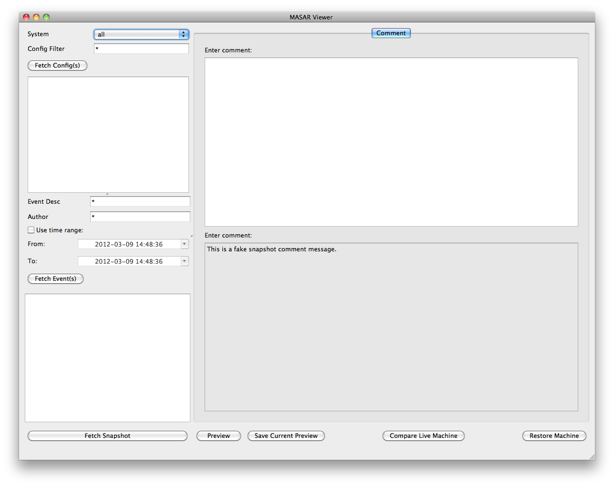
MASAR Main Page

If it can not connect to the MASAR server, a warning dialog will pop up as:

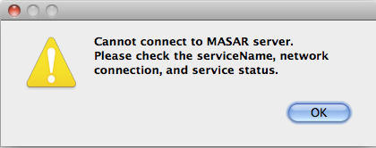
MASAR No Service Dialog

If server is connected successfully, all systems are available as:

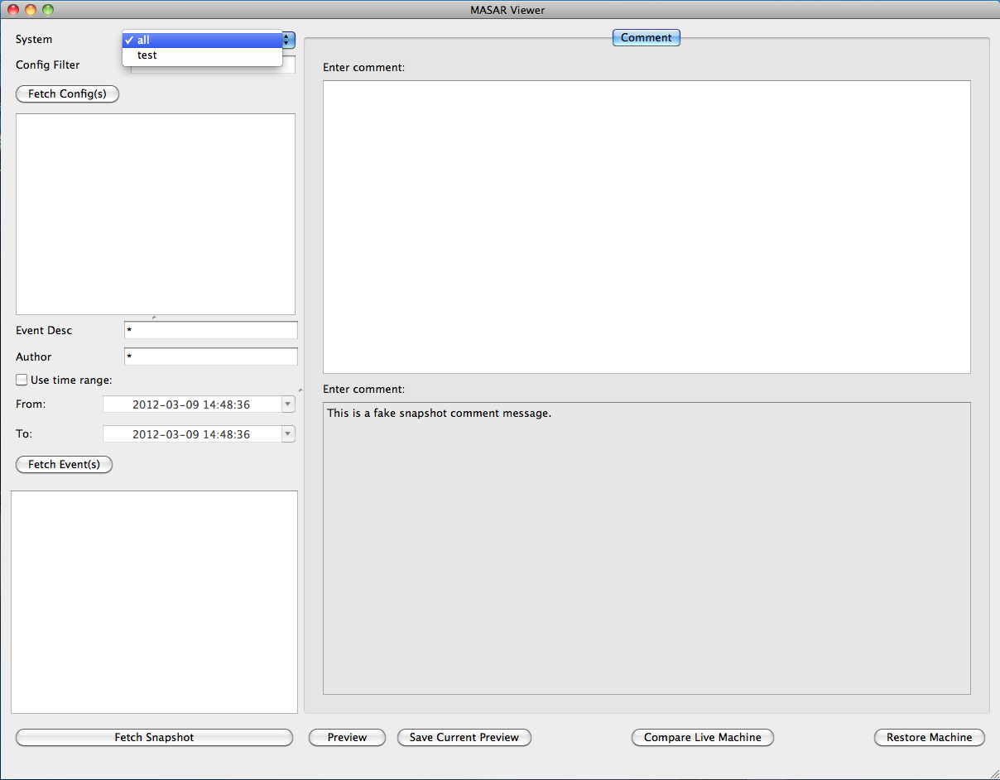
System selection

After selected desired system, click on "Fetch Config(s)" button, all configurations for selected system are retrieved from database and shown in configure table as:

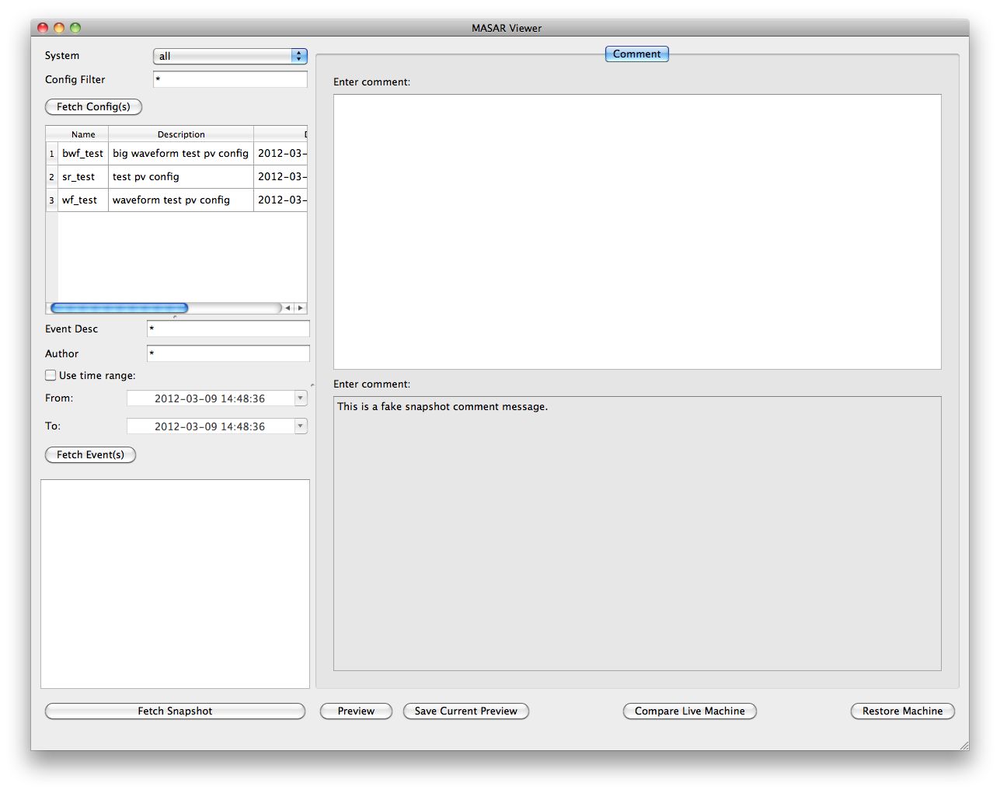
MASAR Configuration List

To select a configuration, click on a row on the configure table, or hold Ctrl key if using for example Linux, or Command key for MAC OS-X + click on different row to select multiple configurations. User is able also to filter the event description, author/user name, and time range.
 After selected configure(s), click on "Fetch Event(s)" button to retrieve event list.

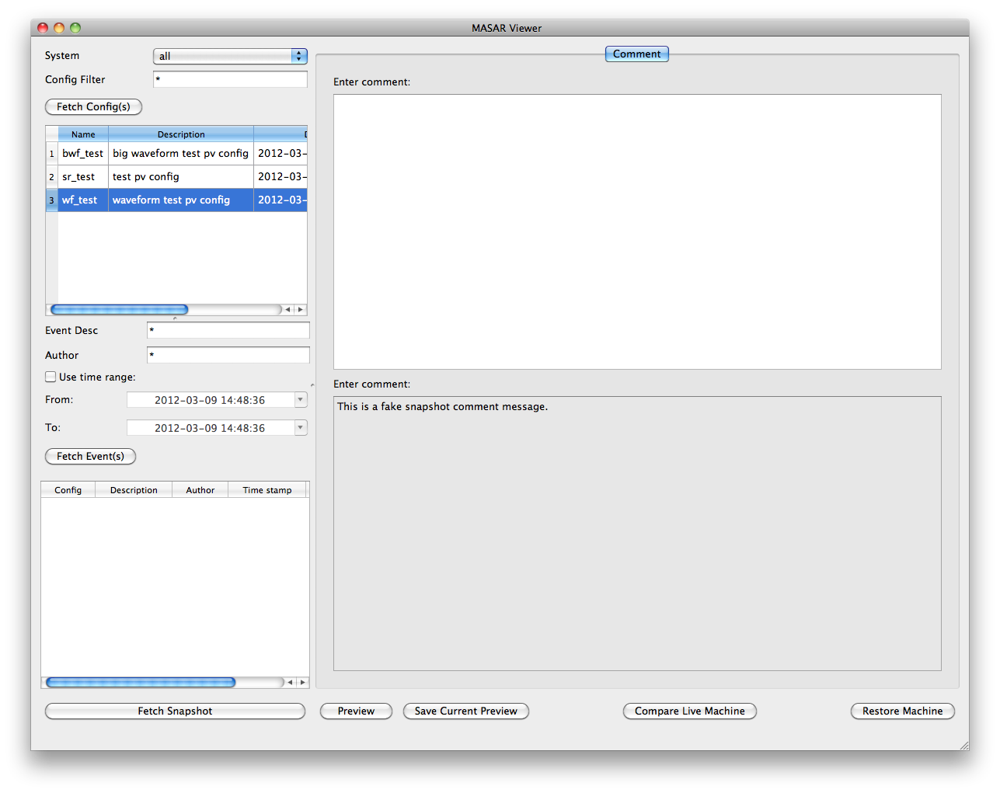
MASAR Event List

If the event table shows nothing above, it means there is no qualified event snapshot for that configuration with given constrains.

 To take a machine snapshot, select one configuration, then click on "Preview Button". A machine preview will be taken, and get a result like:

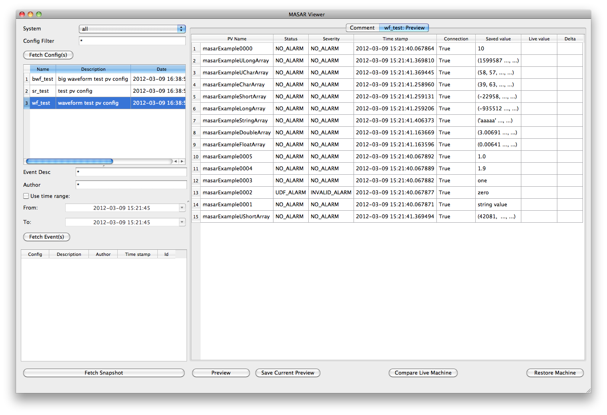
MASAR Snapshot Preview

If there is nothing showing up, it means probably no pv can be connected.
 After verifying the preview, click "Save Current Preview" button to flag this preview approved. A dialog will pop up to confirm as below:

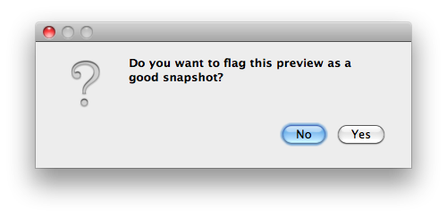
MASAR Approval Dialog

By clicking "Yes", a comment dialog will pop up to ask for Author for who does this, and comment as:

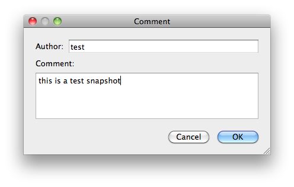
MASAR Snapshot Comment

Click "OK" after done. A success message dialog will show up as:

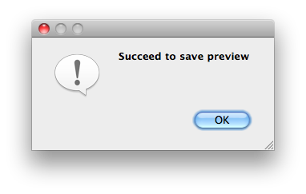
MASAR Snapshot Approved

After saved it, it should appear in event table as follow if clicking "Fetch Snapshot(s)" and make sure correct time range if "Use time range" is checked.

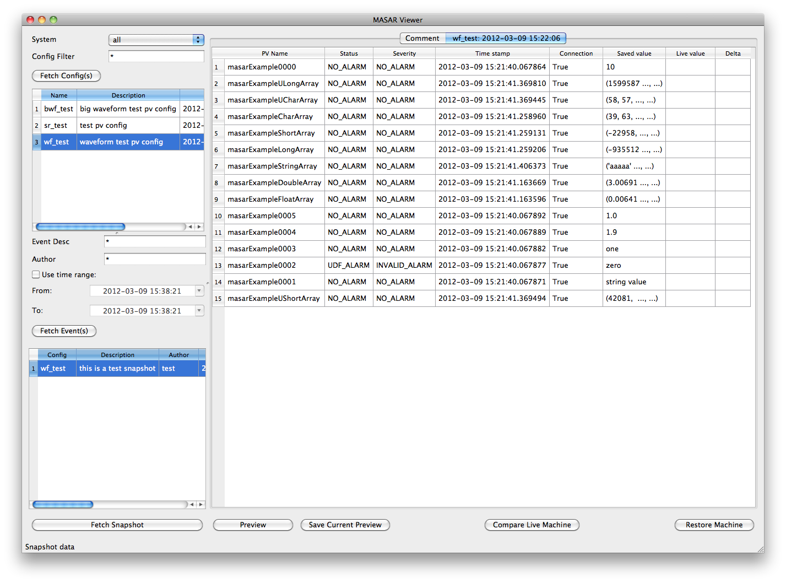
MASAR Snapshot

It can be selected, and appear on right side window by clicking "Fetch Snapshot".

To compare a snapshot with live machine, just click "Compare Live Machine" button, and all live data will display on the same window for all available pv data as below:

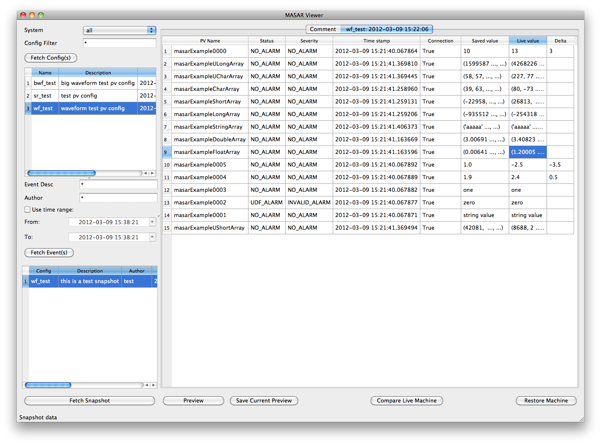
MASAR Compare a Snapshot With Live Machine

The difference between snapshot and live machine will be calculated for a scalar pv. For an array pv, a pop-up dialog will be displayed by double clicking on either "Saved Value" cell or "Live value" cell as:

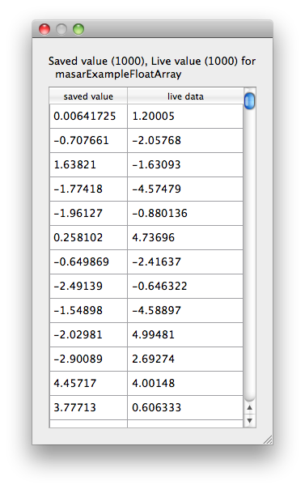
MASAR Compare Array PV

It will display how many points in saved data, and how many in live data, and detailed data value.
 To restore the machine, select one snapshot, and click "Restore Machine" button.
 If for any reasons, an operator does not want to restore all pvs, the operation can be done by checking some pv as below (the masarExample001 will not be restored.):

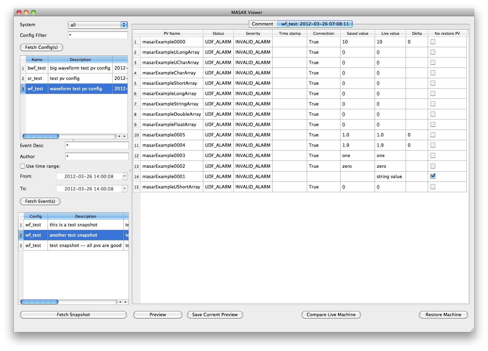

A dialog will be poped up as below to confirm this operation since it might be dangerous.


After finished restoring, a dialog will pop up to show either succeed to restore machine or fail as:

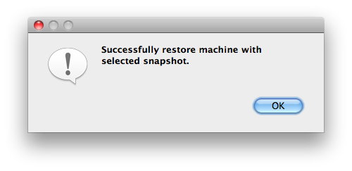
MASAR Restore Confirmation

The restore result can be confirmed by comparing the live machine again as:

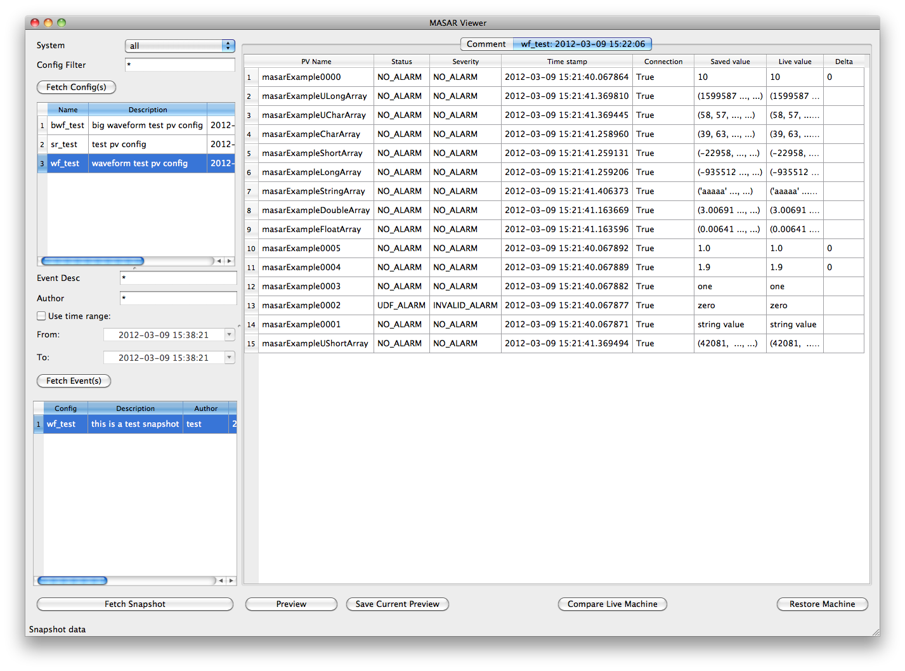
MASAR Compare Restore Result

The data can be saved into a local file by clicking "Save to File" button as below:

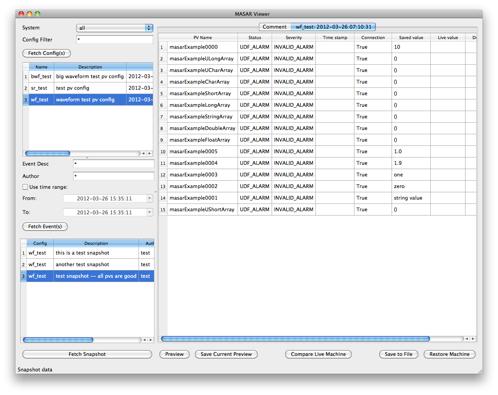

A dialog window will pop up to ask where which file the data should be saved into.

 Guobao Shen, BNL  Last modified: Fri, 24 Jan 2014 22:19:50 +0100
